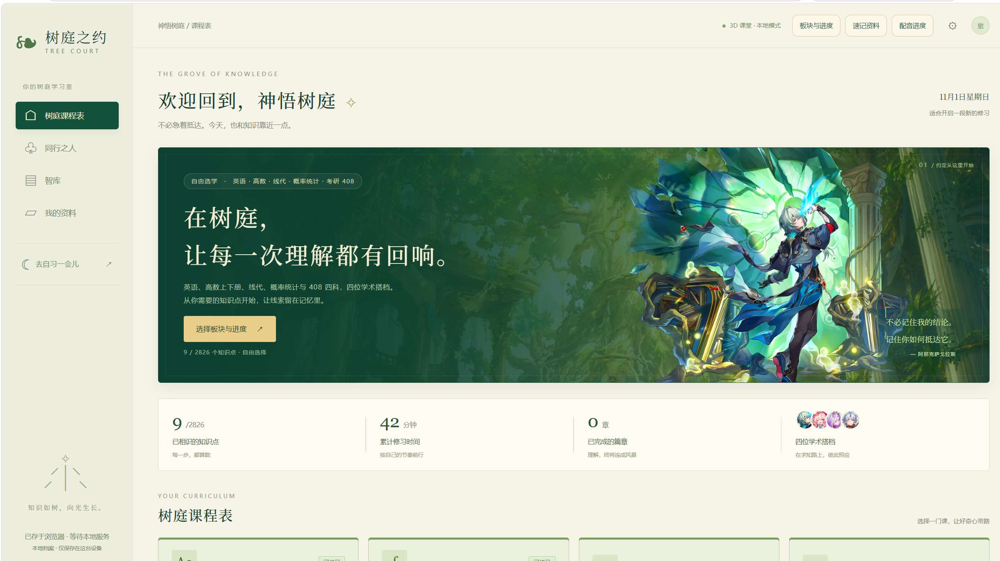
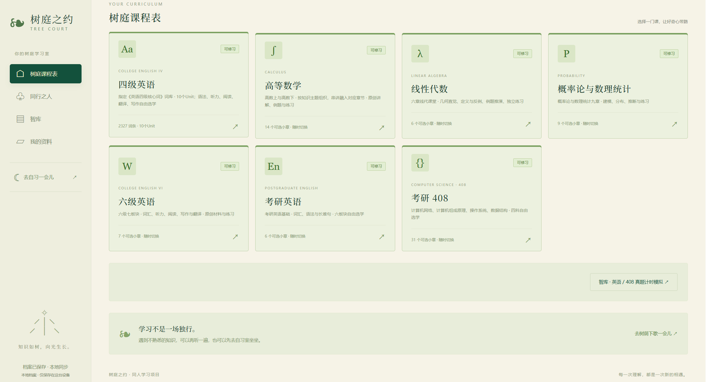
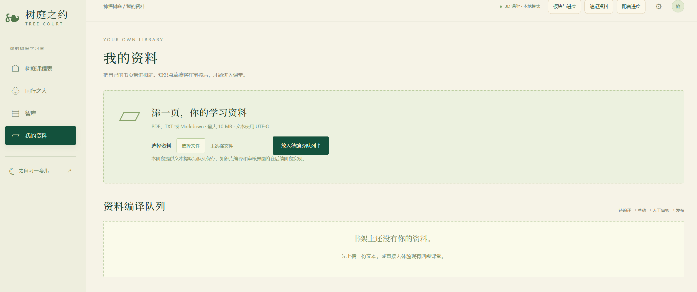

# 树庭之约 · Tree Court Promise

> 交互式修习系统：把课堂做成一间能走进去的房间——四位学术搭档陪你一题一题地过，学过的痕迹留在手札里。



## 界面

**课程表** —— 七门课程，每门标着当前能修习的章节数：



**我的资料** —— 自己上传 PDF / TXT / Markdown，进编译队列：



## 这是什么

一个跑在浏览器里的本地学习应用。打开之后是「神悟树庭」——左侧是课程表、同行之人、智库、我的资料，中间是当天的修习入口，右上是你的搭档。

它不追求把课程一次性塞满，而是把**理解的过程**留在记录里：每次作答都有解释、例句和记忆钩子；好感随理解增长，而不是随签到增长。

目前已经接入的科目：**考研英语、四级、六级、高等数学、线性代数、概率论与数理统计、408 计算机统考、计算机网络讲义**。

## 技术栈

| 层 | 用什么 |
|---|---|
| 后端 | FastAPI + Uvicorn（Python 3.10+） |
| 前端 | 原生 JavaScript，无框架、无构建步骤 |
| 3D 课堂 | Three.js（场景渲染、人物动作、第一人称视角） |
| 存储 | SQLite（本地文件，随项目跑） |

## 快速开始

Windows 一键（首次会自动建虚拟环境、装依赖）：

```powershell
powershell -NoProfile -ExecutionPolicy Bypass -File web/start.ps1
```

手动：

```powershell
# 1. 建环境
python -m venv web/.venv

# 2. 装依赖
web/.venv/Scripts/python.exe -m pip install -r web/requirements.lock.txt

# 3. 起服务
web/.venv/Scripts/python.exe -m uvicorn web.backend.app:app --host 127.0.0.1 --port 8765
```

打开 <http://127.0.0.1:8765>。端口被占用时：

```powershell
powershell -File web/start.ps1 -Port 8766
```

API 文档在 <http://127.0.0.1:8765/docs>。

## 项目结构

```
.
├── web/
│   ├── backend/      FastAPI 应用、领域规则、题库、SQLite 仓储
│   ├── frontend/     页面、样式、状态归约、3D 场景
│   ├── renderer/     Three.js 渲染层（场景/人物/第一人称）
│   ├── tests/        80+ 自动化测试（Python unittest + node --test）
│   ├── start.ps1     一键启动
│   └── package.ps1   打包发布
├── data/             课程目录、词库、真题、教学策略
├── knowledge/        课程编译脚本与生成后的课程数据
├── characters/       四位角色的人设与关系规则
├── assets/           立绘与背景
└── docs/             设计与迭代记录（ADR、验收、课程接入说明）
```

## 功能

- **课程表**：按科目选章，课程进度存在本地，刷新不丢
- **答题反馈**：选择后给出解释、例句、记忆钩子，不弹冷冰冰的对错框
- **好感与关系**：每个知识点首次答对才涨好感，重复提交不刷分；达到阈值开放支线
- **修习手札**：做过的词、待巩固的词都在里面，可以单独重温
- **自习室**：正向计时 / 25 分钟番茄，低音量环境声；切出页面自动暂停，不把后台时间算作专注
- **资料上传**：PDF / TXT / Markdown（10 MB 内），进待编译队列
- **3D 课堂**：浏览器里直接渲染教室与人物，不需要装 UE

## 测试

```powershell
# Python 单元测试
web/.venv/Scripts/python.exe -m unittest discover -s web/tests -v

# 前端状态机
node --test web/tests/state.test.mjs
```

浏览器验收脚本在 `web/tests/*-browser.mjs`，需要 Node.js + Playwright + Edge，先启动本地服务再跑。

## 数据与隐私

- 浏览器 `localStorage` 保存匿名档案 ID 与事件
- 服务端 SQLite 存在 `data/runtime/treecourt.sqlite3`，上传的资料存在 `data/runtime/materials/`
- **全部数据都在本机**，不上传任何服务器
- 换设备要手动迁移 `data/runtime/`

## 关于本仓库的体积

仓库里放的是**代码、课程数据、角色模型和 3D 教室**，约 165 MB。下面这些不进版本库：

- 语音合成产物（`data/voice/`）——十几 GB
- 真题扫描件（`assets/exams/`）——含版权页面
- UE5 工程（`ue5/`）——浏览器版用不到

所以 clone 下来能完整跑课程与 3D 课堂（人物会站在教室里），**但没有配音**。没有语音时播放按钮会提示尚未生成，不影响答题。

## 许可

代码与文档以 [MIT](LICENSE) 许可发布。词库、课程文本、剧情为作者原创；项目中出现的第三方角色同名元素仅为同人创作，版权归原权利方所有。
